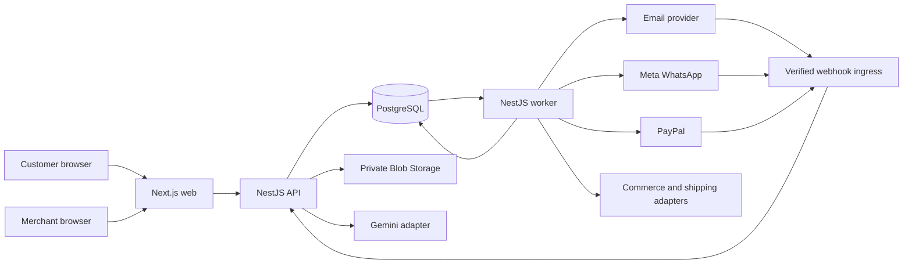

# ResolvePay Rescue — Complete System Design and Agent Implementation Plan

Version: 1.0 | Prepared: 2026-11-10 | Project root: `E:\ResolvePay`

Audience: one AI coding agent, with the owner reviewing its work. This specification describes the entire expanded product and phased delivery beginning with a hackathon MVP. It does not claim that software, accounts, integrations, tests, or deployment already exist. Confirmed user decisions take precedence over suggested implementation defaults.

## 1. Product objective

ResolvePay Rescue resolves failed purchases by understanding what the customer still needs, comparing feasible remedies, obtaining agreement, executing commerce and payment operations, and verifying outcomes.

Example: a customer bought a USD 120 backpack with a broken zipper, needs a replacement before Friday, and can spend USD 15 more. ResolvePay compares a same-item replacement, an alternative-item exchange, and a refund. It shows exact amounts, estimated delivery, policy evidence, return requirements, and approval requirements. A merchant approves the financial plan. Execution rechecks inventory and payment state before irreversible actions.

The differentiator is an inspectable resolution plan plus reliable execution when conditions change. A conversational interface alone is insufficient.

### 1.1 Personas and authority

| Persona | Needs | Authority |
|---|---|---|
| Customer | Explain issue, supply evidence, compare remedies, track outcome | Own authenticated orders/cases; accept terms and approve checkout |
| Merchant owner | Configure policies, staff, integrations, limits | Tenant administration and financial approvals |
| Support agent | Investigate, request information, propose remedies, inspect returns | No financial approval by default |
| Approver | Review evidence and financial consequences | Tenant-scoped approval and documented exceptions |
| Analyst | View outcomes | Read-only aggregates, limited personal data |
| Platform operator | Diagnose failures and provider health | Operational metadata; no default unrestricted tenant access |

### 1.2 Entire product scope

- Full and item-level partial refunds.
- Same-item replacements and alternative-item exchanges with extra payments or price-difference refunds.
- Customer budget, deadline, and preference constraints.
- Policy-grounded plans with citations, versions, approvals, and explicit exceptions.
- Return authorization, inspection, inventory reservation, replacement dispatch, and delivery tracking.
- Unified web, email, and WhatsApp case timeline.
- Payment reconciliation, duplicate prevention, resumable workflows, and operator recovery.
- Photo-assisted evidence, recurring-issue insights, Shopify integration, and automatic limits in later phases.
- Multi-tenant foundations with one merchant in the initial demo.

This is not escrow, a wallet, a payment processor, a fraud-verdict engine, a dispute adjudicator, or an autonomous cross-merchant marketplace. Exchange credits are merchant accounting records, not PayPal balances. Shipping dates remain estimates. Production readiness is a separate gate from a low-budget sandbox demo.

## 2. Confirmed decisions

| Area | Decision |
|---|---|
| Delivery | Full architecture, phased implementation, hackathon MVP first |
| Stack | TypeScript; Next.js frontend; NestJS API and separately runnable worker |
| AI | Google Gemini primary, provider adapter for later alternatives |
| Hosting | Azure Container Apps; managed PostgreSQL; no Redis |
| Budget | Azure target at most USD 30/month; active subscription, no credits assumed |
| Region | Lowest-cost suitable region after actual cost and availability checks |
| AI spending | Prefer free tier; no automatic paid fallback |
| Commerce | Built-in storefront first; Shopify later |
| Payments | Real PayPal sandbox; developer setup still needed |
| Approval | Merchant approves every financial resolution initially |
| Tenancy | Multi-merchant architecture; one merchant launch/demo |
| Demo | Synthetic customers, USD payments, English UI |
| Merchant identity | Google and Microsoft sign-in |
| Customer identity | Secure email links granting access to their orders |
| Channels | Web, email, and WhatsApp in the first release |
| WhatsApp | Direct Meta Cloud API with test resources first |
| Email | Sender `resolvepay@divyansh.live`; verify domain `divyansh.live` |
| Messaging budget | Free/test allowances only; paid messaging needs owner's decision |
| Returns | Simulated shipping; merchant-recorded inspection; policy gates before refund/dispatch |
| Priorities | Core remedies/recovery, then exchanges, photos, insights, Shopify, automatic limits |
| Implementation | One AI coding agent and owner review; hackathon deadline |

### 2.1 Implementation defaults

Use pnpm workspaces, Tailwind CSS with accessible component primitives, TanStack Query, Zod schemas, Drizzle ORM with explicit SQL migrations, PostgreSQL full-text search before embeddings, Vitest, Playwright, Bicep, and GitHub Actions. Use Resend's free-tier email adapter as the default. Application hosting/storage stay on Azure; Gemini, PayPal, Meta, identity providers, and email delivery are external integrations.

Pin compatible stable versions and commit the lockfile during bootstrap. Choose a supported Node LTS and PostgreSQL version available in the selected Azure region; record exact versions in `docs/decisions.md`. Do not invent an available model identifier, quota, package version, or provider capability.

## 3. Releases and completion boundaries

### R0 — Hackathon core

Tenant-safe authentication; synthetic catalog/orders; sandbox checkout/capture; complaint intake; policy-grounded remedy proposals; customer acceptance; merchant approval; return/inspection gates; refunds and same-item replacements; execution timeline; recovery; verified webhooks; real test integrations for web/email/WhatsApp; deployment/run instructions; evaluation fixtures; submission assets.

Each channel supports a narrow complete journey: complaint intake, clarification, secure portal handoff, and outcome notification. Customer remedy acceptance and merchant financial approval occur in the authenticated portal, not through interpretation of chat replies.

If provider setup blocks a channel, implement its adapter/tests and report the external prerequisite. Mark the channel unavailable. A simulated inbox is development infrastructure, not proof of a real integration. R0 is incomplete if a user-required channel remains unavailable; do not silently move it to a later release.

### R1 — Expanded recovery

Alternative-item comparison; extra-payment and cheaper-item exchanges; deadline/budget filtering; stale-plan replanning; photo evidence; richer comparison UI.

### R2 — Merchant operations

Recurring-issue insights; Shopify; richer returns/fulfillment adapter; reconciliation exports; localization foundations; multi-merchant pilot onboarding.

### R3 — Controlled production

Automatic limits; real-customer privacy and AI-processing review; live PayPal permissions/partner approval where required; real shipping; security/capacity review; measured backup/restore; revised operating budget. The USD 30 demo budget does not imply production deployment fits it.

## 4. System architecture

Use a modular monolith. API and worker share domain code and PostgreSQL. Do not split business modules into independent microservices for the MVP. Provider adapters are replaceable, but money, approvals, and tenant boundaries remain explicit.



This diagram represents logical flow. PostgreSQL does not wake a zero-replica worker automatically; a scheduled Container Apps Job claims durable work independently of HTTP traffic.

### 4.1 Module boundaries

| Module | Owns | Invariant |
|---|---|---|
| Identity/Tenancy | Sessions, identities, memberships, order grants | Establish actor/tenant before domain access |
| Catalog/Orders | Products, inventory, immutable order snapshots, checkout | Server prices are authoritative |
| Cases | Messages, evidence, customer constraints | Message text grants no financial authority |
| Policy | Versioned clauses and structured rules | Published versions immutable |
| Planning | Context, model calls, option explanations | AI output is advisory and validated |
| Approvals | Customer acceptance and merchant authorization | Bound to exact plan hash/version |
| Resolution | Saga and recovery | External success is verified, not assumed |
| Payments | PayPal operations and reconciliation | Model has no direct payment tool |
| Fulfillment | Reservations, returns, inspection, shipment | All dispatch gates enforced |
| Channels | Email, WhatsApp, web, notifications | Verified inbound and tenant mapping |
| Insights | Deterministic aggregates, cited summaries | No autonomous policy change |
| Operations | Audit, failures, quotas, health | Recovery preserves financial invariants |

### 4.2 Repository layout

```text
apps/
  web/                  Next.js UI; same-origin API forwarding
  api/                  NestJS HTTP and provider webhooks
  worker/               NestJS application context and bounded job runner
packages/
  contracts/            Zod schemas, DTOs, generated API types
  domain/               Money, policies, state machines, plan validation
  db/                   Drizzle schema, SQL migrations, RLS, transactions
  integrations/         PayPal, Gemini, Meta, email, commerce, storage
  observability/        Logs, redaction, metrics, correlation IDs
  ui/                   Shared accessible components
  test-fixtures/        Synthetic tenants, catalog, policies, labeled cases
infra/
  bicep/                Azure resources and cost controls
  docker/               Production Dockerfiles and local Compose
docs/
  decisions.md          Versions, tradeoffs, changed requirements
  progress.md           Verified milestones and blockers
  setup.md              Accounts and configuration
  operations.md         Recovery, backup, restore, quotas
  cost-estimate.md       Regional prices and assumptions
  evaluation.md         Methods, actual results, limitations
  submission.md         Demo and project description
plan.md
```

Dependencies point from applications to shared domain/integration packages. Domain code does not import controllers, Next.js, or concrete provider clients. No circular package dependencies.

## 5. Azure topology, costs, and execution model

### 5.1 Demo resources

- One resource group and Container Apps consumption environment.
- Web Container App: external HTTPS, min replicas 0, max 1 initially.
- API Container App: HTTPS provider callback endpoint; browser API calls forwarded through web origin; min 0, max 1.
- Scheduled worker Job: every 5 minutes, bounded batch, 120-second initial timeout, one replica. UTC cron. Measure runtime/cost before increasing frequency.
- Smallest suitable PostgreSQL Flexible Server burstable tier; no HA for demo; minimum adequate supported storage.
- Private Azure Blob evidence container with lifecycle cleanup.
- Prefer free public GHCR images for the open-source application, without private data/secrets. Include Azure Container Registry's fixed cost before substituting it.
- Minimal logging, bounded retention, managed identities and scoped secrets.

Container Apps can scale to zero. PostgreSQL does not automatically follow HTTP traffic to zero. Budget continuous database availability while judges need access. Do not shut it down during judging to make an unaffordable estimate appear viable.

### 5.2 Fast interaction with durable background work

Persist a command and durable step before attempting side effects. The API may execute one bounded step synchronously within the request using the same lease/handler as the worker. Never depend on an unawaited promise after returning a response.

Long work returns HTTP 202 with operation ID. The worker independently drains ready jobs. Browser polling backs off and stops on terminal state or hidden tab. Webhooks can settle operations before the next scan. The five-minute scheduling delay is an explicit demo limitation.

Production may use event-driven jobs or an always-available worker after cost/capacity review. A database queue alone does not wake a zero-replica service; verify the trigger mechanism before changing deployment mode.

### 5.3 Cost feasibility gate

Compare at least two eligible regions using current Azure calculator/retail prices and subscription SKU availability. Include 730 hours of database compute, minimum storage, backups, app/job usage above shared allowances, registry, logs, egress, Blob operations, network/DNS charges, and relevant taxes. Account for other workloads using subscription-level free allowances.

These are allocation targets, not quoted prices:

| Category | Monthly allocation target |
|---|---:|
| Managed PostgreSQL compute/storage/backups | USD 20 |
| Container Apps and jobs | USD 4 |
| Blob, logging, networking, incidental resources | USD 2 |
| Contingency | USD 4 |
| Total | USD 30 |

If the estimate exceeds USD 30, report the shortfall and propose concrete alternatives to the owner. Do not silently replace managed PostgreSQL with an external database or enable paid AI. Azure budgets alert; they are not a hard spending cap. Set alerts at USD 15/24/28, restrict replicas/jobs/uploads, and retain headroom for billing lag. No paid messaging without the owner's decision.

### 5.4 Database networking and connections

Use TLS with hostname/certificate verification. Prefer private networking if its full cost fits. Otherwise restrict public PostgreSQL access to the documented Container Apps environment outbound IP set and verify API/worker connectivity and deployment-time changes. Never use the broad all-Azure-services exception as a shortcut. If restrictive connectivity requires additional cost, revisit the estimate.

Initial connection pools: API 5, worker 3, migration 1; validate against actual SKU limits. No database access from frontend. Separate migration, API, worker, and scheduler capabilities. Managed identity accesses Blob where supported. Runtime secrets are not image build arguments.

## 6. Authentication and tenant isolation

### 6.1 Merchant login

Google and Microsoft OIDC authorization-code flow with PKCE, using a maintained OIDC library. NestJS owns sessions. Validate issuer, audience, nonce, state, exact redirects, and token signatures. Identify users by `(issuer, subject)`; do not merge identities solely by matching email. Membership/invitation grants merchant access; public sign-in never creates an owner role.

Use opaque random session tokens with stored hashes and Secure/HttpOnly/SameSite cookies. Default merchant expiry: 8-hour idle, 24-hour absolute. Mutations require CSRF/Origin checks. OAuth callbacks and provider webhooks use their dedicated verification. Reauthenticate before integration credential changes and high-risk operational overrides.

### 6.2 Customer links

Order lookup accepts merchant slug, order reference, and email; always returns a generic response. Send a one-time token only to the address already on a matching order. Hash tokens; expire after 15 minutes; rate-limit destination/IP. Redeem for an order-scoped session, default expiry 24 hours.

Do not consume the token on GET because email scanners may prefetch. Use a confirmation POST. Token pages use no-store, no-referrer, no third-party scripts; scrub URLs from logs. An order ID, phone number, email From header, or PayPal return URL is not proof of order ownership.

WhatsApp identity is linked through the authenticated portal. Before linking, accept only generic inquiries and offer the access flow without disclosing order details. Customer remedy acceptance occurs in the portal against a specific plan hash.

### 6.3 Tenant enforcement

Every tenant-owned table includes `tenant_id`; parent-child relations use composite tenant/id foreign keys. Every query includes tenant constraints. PostgreSQL row-level security is additional protection.

Set tenant context transaction-locally with `set_config`; never leave session-scoped tenant state in a connection pool. Runtime roles do not own tables or have BYPASSRLS. Force RLS where applicable. Missing tenant context denies access. Test with two tenants even though only one launches.

Global session/identity lookup and job discovery need narrowly scoped paths. A restricted scheduler claim function returns only job/tenant identity; payload processing then runs under tenant context. Do not give the normal API role broad cross-tenant rights to simplify jobs. Authorize storage URLs, caches, search, exports, and worker actions as strictly as HTTP reads.

## 7. Relational data model

Use UUID primary keys, UTC `timestamptz`, `created_at`, `updated_at`, and integer `version` for concurrent aggregates. Money uses bigint minor units plus ISO currency; JSON serializes minor units as decimal strings to avoid JavaScript precision loss. Never use floats. USD exponent is two; add a verified exponent table before other currencies.

### 7.1 Identity/configuration

| Table | Essential fields/constraints |
|---|---|
| tenants | id, unique slug, name, status, default_currency, timezone |
| users | id, name, status |
| oidc_identities | user_id, issuer, subject; unique issuer/subject |
| memberships | tenant_id, user_id, role, status; unique tenant/user |
| sessions | token_hash unique, subject_type/id, tenant_id, expires_at, revoked_at |
| order_access_grants | tenant_id, customer_id, order_id, session_id, expires_at |
| access_tokens | hash, purpose, tenant_id, order_id, expires_at, consumed_at |
| integration_connections | tenant_id, provider, mode, external_account_id, secret_reference, capabilities, status |
| channel_identities | tenant_id, customer_id, provider, external_subject, verified_at, consent_at, revoked_at |
| settings_versions | tenant_id, version, validated settings, author, effective_at |

### 7.2 Commerce/financial records

| Table | Essential fields/constraints |
|---|---|
| customers | tenant_id, encrypted_email, email_lookup_hash, name, locale |
| products/variants | tenant_id, tenant-unique SKU, attributes, price_minor, currency, active |
| inventory | tenant_id, variant_id, location_id, on_hand, reserved, version; nonnegative |
| reservations | tenant_id, plan_id, variant_id, quantity, state, expires_at; unique business purpose |
| orders | tenant_id, customer_id, source/source_id, currency, totals, payment/fulfillment status |
| order_items | tenant_id, order_id, variant_id, quantity, immutable price/title/tax/discount snapshots |
| payment_operations | tenant_id, order_id, resolution_id, type, logical_key, request_hash, provider_request_id, state |
| captures | tenant_id, order_id, provider_capture_id, amount_minor, currency, status, refunded_minor |
| refunds | tenant_id, capture_id, resolution_id, provider_refund_id, amount_minor, currency, status |
| item_remedy_allocations | tenant_id, order_item_id, quantity, remedy, plan_id, state |
| journal_transactions | tenant_id, unique business_event_key, currency, occurred_at, provider_reference |
| journal_entries | tenant_id, transaction_id, account_code, debit_minor, credit_minor |

Order pricing is server-side. Allocate discounts/taxes with a documented largest-remainder rule so line allocations equal totals. Shipping refunds are separate policy rules. R0 may use explicitly configured zero-tax fixtures; do not treat that as production tax behavior.

### 7.3 Cases/plans/execution

| Table | Essential fields/constraints |
|---|---|
| cases | tenant_id, order_id, customer_id, state, issue_type, constraints, version |
| messages | tenant_id, case_id, channel, provider_message_id, sender_role, body, verification_state |
| evidence | tenant_id, case_id, blob_key, content_hash, media_type, validation_state, retention_until |
| policy_versions | tenant_id, version, text, effective_at, publisher, immutable_hash |
| policy_clauses | tenant_id, policy_version_id, key, text, structured_rule, source_span |
| ai_runs | tenant_id, case_id, model/prompt version, input_hash, result, usage, latency, state |
| plans | tenant_id, case_id, version, hash, policy_version_id, option_type, totals, input_snapshot, expires_at, state |
| plan_citations | tenant_id, plan_id, source_type/id/version, excerpt |
| approvals | tenant_id, plan_id/hash, actor_type/id, decision, scope, expires_at |
| resolutions | tenant_id, case_id, plan_id, state, current_step, version |
| resolution_steps | tenant_id, resolution_id, step_key, state, lease_owner/until, fencing_token, attempt, external_reference |
| returns | tenant_id, case_id, item quantities, status, tracking_ref, inspection_result, inspector |
| fulfillments | tenant_id, resolution_id, replacement_order_id, status, tracking_ref, estimate, delivered_at |

### 7.4 Reliability/operations

| Table | Essential fields/constraints |
|---|---|
| webhook_inbox | provider, connection_id, event_id unique per connection, raw_hash, verified_at, received_at, state |
| jobs | tenant_id, type, dedupe_key, payload_reference, ready_at, state, attempts, lease_until |
| outbox_events | tenant_id, aggregate_id, event_type, unique event_key, payload, published_at |
| notifications | tenant_id, case_id, channel, recipient_ref, event_key, state, provider_id, error |
| audit_events | tenant_id, actor, action, aggregate_id, before/after hashes, trace_id, occurred_at |
| quota_counters | scope, window_start, metric, reserved_units, used_units; atomic updates |
| insight_snapshots | tenant_id, period, grouping, counts, evidence_case_ids, sample_size |
| idempotency_records | tenant_id, actor_scope, route, key, request_hash, operation_id, response_state |

Indexes: tenant/state/created_at for cases; tenant/customer for orders; unique provider IDs per connection; partial ready-jobs index on ready_at; lease-expiry scan; tenant/case/created_at on messages; policy full-text index; unique operation logical key. Large files live in Blob. Raw webhook data is short-lived and restricted.

### 7.5 Financial invariants and subledger

1. Settled plus locally reserved in-flight refunds cannot exceed authoritative captured value minus externally completed refunds.
2. One logical operation keeps one provider request ID and identical payload across retries.
3. Item quantities cannot receive incompatible overlapping remedies without an explicit approved exception.
4. Journal entries balance debits/credits per transaction and currency. Enforce in the posting transaction plus a deferred database validation trigger or equivalent database-enforced mechanism.
5. Pending provider operations are not settled money.
6. Fees and unknown net settlement amounts are separate; never infer net cash from gross sales.

Accounts include PayPal clearing, revenue, tax payable, shipping revenue, sales returns, exchange credit liability, fees, and replacement expense. This is an operational subledger, not a complete tax-accounting product. Journal history is append-only; correction uses reversal entries.

For a USD 120 returned item exchanged for USD 130: recognize an eligible noncash return credit of USD 120 only after required inspection; consume it once against the new order; capture USD 10 through PayPal. Funding totals USD 130. Do not also refund the USD 120. Cancelling an unused credit reverses its entries. Refunds and exchange-credit consumption share item-allocation guards.

## 8. Policy and AI planning

Merchant rules cover return window, issue eligibility, item condition, evidence/inspection requirements, refundable shipping, replacement allowance, approver role, and exceptions. Policy text remains readable and cited. AI may draft structured rules; only the merchant publishes executable rules.

Published policies are immutable versions. Snapshot applicable terms on each order. Do not silently apply a later restrictive rule to an older purchase. Contradictory/ambiguous policy goes to human review. Exceptions create a new plan with reason and approver; they never bypass payment ownership or ceilings.

Pipeline:

1. Authenticate and load scoped order/case.
2. Normalize messages as untrusted data.
3. Gemini extracts issue, item references, constraints, and missing facts.
4. Server validates referenced items/quantities.
5. Retrieve tenant policy clauses through full-text search and structured rule selection.
6. Deterministic code enumerates eligible remedies.
7. Filter options by stock, budget, currency, returns, and delivery estimates.
8. Gemini explains feasible options using supplied evidence only.
9. Validate citations, amounts, and unsupported claims; escalate when needed.
10. Persist immutable proposal, source versions, hash, and expiry.

Suggested initial proposal validity: 15 minutes. Reserve inventory for 10 minutes after selection, not indefinitely during a physical return. After inspection recheck availability and regenerate materially changed plans. No hidden preference for exchanges over an eligible refund. If all constraints cannot be satisfied, show the conflict and ask for a tradeoff.

### 8.1 Provider contract

```ts
type Money = { currency: string; minor: string };
type ValidatedIssue = {
  issueType: 'damaged' | 'missing' | 'wrong_item' | 'cancel' | 'other';
  itemRefs: Array<{ orderItemId: string; quantity: number }>;
  constraints: { maxExtra?: Money; neededBy?: string; timezone?: string };
  missingFacts: string[];
  evidenceRefs: string[];
};
interface AiProvider {
  extractIssue(input: RedactedCaseContext): Promise<ValidatedIssue>;
  explainOptions(input: GroundedOptions): Promise<ValidatedExplanation>;
  describeEvidence?(input: SafeImageContext): Promise<EvidenceObservation>;
}
```

Use maintained Google SDK structured output plus Zod runtime validation. Choose a currently available free-tier-eligible model with usable account quota; record its exact ID. No automatic paid fallback, paid search grounding, or required paid embeddings. Limit R0 to two planned model calls per proposal and at most one schema-repair call within quota.

Never send names, emails, phone numbers, addresses, tokens, payment IDs, or real customer images to free-tier Gemini. Use synthetic demo content and opaque references. Strip signatures/headers before prompts. Real-customer processing needs a separate decision about processing terms.

Bound input/output size, concurrency, daily calls, and per-case attempts. Inspect active AI Studio limits; do not assume a universal quota. Reserve local quota before calls. On 429 honor timing and use bounded retries. Exhaustion shows 'AI unavailable; merchant review available.' Cache by tenant, input hash, policy version, model, and prompt version; stale cached text cannot authorize new actions.

### 8.2 Evidence and injection controls

Customer text, attachments, and policy documents are data, not instructions. Model has no unrestricted SQL, shell, network, or payment tools. Source IDs are allowlisted and validated. Test injection in complaints and policy text. Store concise evidence-backed explanations, not hidden chain-of-thought. Photo observations cannot authenticate an image or conclusively detect fraud.

## 9. Plan contract and approvals

A plan includes tenant/case/order IDs, version/hash, item quantities, remedy type, customer charge/refund, merchant cost, return conditions, exact payment steps, reservations/expiry, citations, policy version, delivery source/time/estimate, exceptions, required approvals, and recovery behavior.

Hash canonical material terms server-side. Customer acceptance and merchant approval bind to the same hash. Changes to amount, currency, item, return requirement, payment route, or delivery expectation invalidate both. Ordinary status updates do not. Approval can expire or be revoked before execution; neither approval nor buyer checkout approval alone means a resolution completed.

Before execution, lock/revalidate plan version, consent, merchant role, refund balance, item allocation, inventory, and inspection. Support agents cannot approve through a hidden API. Manual exceptions must record who changed what and why. Long return workflows revalidate after inspection and obtain fresh acceptance when terms changed.

## 10. State machines

Separate machines prevent misleading combinations such as 'resolved' while a refund is pending.

| Aggregate | Main states / branches |
|---|---|
| Case | OPEN → NEEDS_INFORMATION or PLANNING → OPTIONS_READY → AWAITING_APPROVALS → EXECUTING → RESOLVED; MANUAL_REVIEW branch |
| Plan | DRAFT → VALIDATED → OFFERED → SELECTED → READY → EXECUTING → COMPLETED; SUPERSEDED/EXPIRED/REJECTED branches |
| Resolution | PREPARED → WAITING_RETURN / WAITING_PAYMENT / RUNNING → WAITING_PROVIDER / WAITING_FULFILLMENT → COMPLETED; RECOVERY_REQUIRED/MANUAL_REVIEW/CANCELLED |
| Step | READY → CLAIMED → IN_FLIGHT → SUCCEEDED; RETRY_WAIT/UNKNOWN/FAILED_FINAL/COMPENSATING/COMPENSATED |
| Refund | PREPARED → SUBMITTED → PENDING/COMPLETED/FAILED/UNKNOWN |
| Checkout | CREATED → BUYER_APPROVED → CAPTURE_PENDING → CAPTURED; CANCELLED/EXPIRED/FAILED/UNKNOWN |
| Return | REQUIRED → AUTHORIZED → IN_TRANSIT → RECEIVED → INSPECTION_PASSED/INSPECTION_FAILED |
| Reservation | ACTIVE → CONSUMED/RELEASED/EXPIRED |
| Fulfillment | PLANNED → RESERVED → DISPATCH_READY → SHIPPED → DELIVERED; BLOCKED/CANCELLED/EXCEPTION |
| Notification | QUEUED → SENDING → ACCEPTED → DELIVERED; BLOCKED/UNKNOWN/FAILED/SUPPRESSED |

Implement transitions with explicit guards and events. Store raw provider status separately. Timeout is UNKNOWN, not definitive failure. Accepted request is not final settlement/delivery. Never regress completed financial status due to an older event. Resolve a case after confirmed refund or completed replacement outcome; label simulated delivery explicitly. Initiated refund and dispatched replacement remain progress states.

## 11. End-to-end workflows

### 11.1 Original purchase

Validate cart against current server catalog; create local order; create PayPal order with server totals. Buyer approves via PayPal. Return handler checks actual provider state and ownership, never trusting URL parameters as proof. Capture server-side using persisted request ID. Store capture ID/currency/amount/state. Reconcile before marking paid. ResolvePay never collects card details.

### 11.2 Partial/full refund

1. Match complaint to authenticated items; request missing facts.
2. Calculate eligibility from immutable allocations, policy, prior remedies, and capture balance.
3. Show plan; get customer acceptance and merchant approval.
4. When required, authorize return, record simulated tracking/receipt, and require merchant inspection.
5. Revalidate; regenerate changed terms and approvals.
6. In a short transaction lock capture/item allocations, reserve amount, create step/operation/outbox; commit.
7. Call refund outside the DB transaction with persisted key/body.
8. Persist result. Unknown retains reserved amount and reconciles. Completed posts journal and item allocation.
9. Notify actual status. Notification failure never reverses an already completed refund.

### 11.3 Same-item replacement

Complete policy/consent/inspection gates. Atomically reserve stock after inspection. Create linked replacement order with explicit no-extra-payment funding. Consume reservation when committing fulfillment; dispatch and track outcome. No PayPal refund is implied by replacement. If stock disappears before commitment, invalidate the plan and offer alternatives. Already dispatched shipments require recovery, not a fictitious rollback.

### 11.4 More expensive exchange

Default route uses merchant credit, not refund-and-rebuy. USD 120 eligible return plus USD 10 buyer payment funds a USD 130 replacement. Credit becomes available after required inspection and can be consumed once.

Obtain fresh acceptance/merchant approval, reserve stock, create USD 10 PayPal checkout, and obtain explicit buyer approval. Recheck reservation before capture. After confirmed capture, atomically consume credit/reservation and commit replacement order. If commitment fails after capture, attempt bounded repair; otherwise create a recovery plan for the USD 10 refund. Initially merchant approval is required for recovery money movement unless the exact contingency was explicitly included in the original approval.

Reservation expiry blocks new capture; require a new plan. Reconcile races where capture was already requested. Do not hold stock indefinitely or treat a late buyer approval as permission to execute stale terms.

### 11.5 Cheaper exchange

USD 120 eligible return, USD 100 replacement: allocate USD 100 credit and refund USD 20 against original capture. Both consequences appear in one approved plan. Track fulfillment/refund independently; complete only when both succeed. If replacement fails after USD 20 refund, remaining exposure is USD 100, not USD 120. Compute from allocations/journal, never model memory.

### 11.6 Refund then repurchase

Optional later route when credit is unavailable. Explain that the new purchase may require full payment before refund proceeds are available. Do not imply a pending refund automatically funds checkout. Require fresh buyer approval and display independent outcomes.

### 11.7 Inspection failure

Record inspector, timestamp, quantities, result, and evidence. Show policy basis and route disagreement to review without fraud accusations. Partial returns operate at quantity level. Never automatically mark a promised remedy completed or silently release it after contested inspection.

## 12. Saga, concurrency, and recovery

Each external side effect is a durable step with guards, idempotency, and recovery. PostgreSQL cannot atomically commit with PayPal, Meta, or a shipping provider.

### 12.1 Job execution

Claim ready work with `SELECT ... FOR UPDATE SKIP LOCKED` in a short transaction. Set owner, lease expiry, and incrementing fencing token. Commit before external calls. Completion writes require the current fencing token. Expired leases permit reconciliation/retry, not a new payment key. Fencing protects local writes; provider idempotency protects external effects.

Business mutation and outbox event commit together. Dispatcher inserts deduplicated jobs. Duplicate dispatch is acceptable; duplicate money movement is not. Worker drains a bounded batch and records progress before exiting. Periodic scans find stale UNKNOWN/IN_FLIGHT work even after dispatcher failures.

### 12.2 Retry policy

- Read/transient errors: bounded exponential backoff with jitter.
- Mutation timeout: UNKNOWN; reconcile authoritative state; reuse original key/body only within verified provider semantics.
- 429: honor Retry-After and quotas.
- Permission/validation failure: stop automatic retry and expose configuration/business error.
- DB deadlock/serialization failure: retry short transaction, bounded attempts.
- Exhausted retries: manual queue with permitted next steps.

Default transient delays: 10 seconds, 1 minute, 5 minutes, 30 minutes, 2 hours; worker schedule may delay actual execution. Financial unknown-state reconciliation is separate from blind mutation retry. Provider idempotency retention varies by endpoint; verify it during integration. Beyond the safe window, reconcile or require manual review.

### 12.3 Failure matrix

| Failure | Required response |
|---|---|
| Provider success, local response lost | Reconcile stored operation; no second financial effect |
| Duplicate click | Return original operation |
| Two approvers/cases race | Version/row locks and item allocations select one compatible execution |
| Stock changed | Supersede plan and get fresh consent |
| Refund outside application | Reconcile balance; block overlapping remedy |
| Pending refund | Preserve reservation and display pending |
| Extra charge succeeds, fulfillment fails | Recovery required; repair or approved extra-payment refund |
| Notification fails | Keep correct business outcome; expose delivery failure |
| Worker dies | Lease expiry, reconciliation, resume |
| AI quota exhausted | Manual review, no fabricated live result |
| Database unavailable | No new financial side effects without durable intent |
| Forged/replayed event | Reject unverified input; dedupe verified replay |
| Old event arrives late | Record event; fetch current provider state; no regression |

## 13. PayPal adapter

One sandbox seller REST app and sandbox buyers initially. Secret stays backend-only; public client ID can be exposed as intended. Separate sandbox/live credentials/hosts. Live disabled by default and not enabled through UI alone.

Implement create/show order, capture, show capture, refund, show refund, webhook registration/verification through official REST contracts or a maintained SDK. Do not assume an agent toolkit exposes all needed semantics.

Webhook ingress preserves raw body, identifies connection using configured opaque route key, verifies with correct app webhook ID, persists deduplicated inbox, then acknowledges. Verification failure never becomes a trusted event. Transient verification service failure returns a retryable result; process only verified records. Validate payee, amount, currency, and local correlation, not event type alone.

Subscribe to applicable capture/refund/approval-reversal/dispute events after checking exact current names. Fetch provider state when payload lacks facts. Disputed/incompatible captures pause normal refund automation and enter review.

Production multi-seller integration requires authorized seller onboarding and appropriate platform approval. Tenant-ready code does not grant rights to act for arbitrary sellers. Never solicit PayPal passwords or reuse one merchant's credentials for another.

## 14. Channel integrations

```ts
interface ChannelAdapter {
  verifyInbound(raw: Uint8Array, headers: Record<string, string>): Promise<VerifiedEvent>;
  normalize(event: VerifiedEvent): Promise<NormalizedMessage>;
  send(input: AuthorizedNotification): Promise<SendResult>;
}
```

All adapters write the same case timeline. Keep provider IDs, timestamps, identity binding, and verification/delivery state. Dedupe per connection/provider message ID. A textual order ID does not establish thread ownership.

### 14.1 Email

Default Resend transactional free-tier adapter; sender `resolvepay@divyansh.live`. Verify `divyansh.live` and required SPF/DKIM; configure DMARC without overwriting existing DNS blindly. Use a dedicated receiving subdomain such as `reply.divyansh.live` if supported by verified account capabilities. Inspect existing MX/SPF before changing records.

Reply addresses contain opaque thread references, not authorization tokens. Provider-signed inbound delivery does not prove human sender identity. Unlinked/suspicious replies remain unverified and cannot approve payments or reveal order details. Sensitive activity uses secure portal access.

R0 includes access links, clarification/status notifications, and complaint/reply intake through verified receiving setup. Record accepted/delivered/bounced/failed separately. Escape content in text/HTML templates. Set local daily/monthly caps below actual account free allowances, reserving capacity for access links. No paid overage or marketing campaigns. Local mail viewer is development-only and never public.

### 14.2 WhatsApp

Use Meta test phone resources and authorized test recipients. Store tokens/app secret server-side; verify webhook challenge and raw-body signature. Map configured phone-number ID to tenant. Deduplicate inbound/delivery events and expose token expiry/setup failures.

Reverify current window, template, opt-in, and pricing rules in official Meta documentation/console. Official pages were rate-limited during research; this plan makes no claim that production service messages are free. Set `PAID_MESSAGING_ENABLED=false`; send only when test/free allowance is confirmed, otherwise BLOCKED with portal fallback.

Accept generic initial inquiry, then require secure order linking before details. Send concise status and portal link, not full financial records. Conversational 'yes' is not financial consent. Honor opt-out. Apply evidence upload controls to media. Never resend merely to evade policy restrictions.

### 14.3 Notification reliability

Outbox generates one event/channel/recipient notification key. Commit business outcome before sending. Use provider idempotency where available. For ambiguous send without provider dedupe, reconcile/manual review rather than repeated sends. Exactly-once delivery is not promised.

## 15. HTTP contracts

Base `/api/v1`; OpenAPI generated from validated schemas; frontend types generated from contracts. Browser uses same-origin forwarding; NestJS owns authorization. Webhooks reach dedicated API routes directly. Enforce payload sizes and reject unknown sensitive fields.

| Endpoint | Purpose |
|---|---|
| GET `/auth/:provider/start` and `/callback` | OIDC |
| POST `/customer/access/request` and `/redeem` | Rate-limited scoped access |
| POST `/auth/logout` | Session revocation |
| GET `/catalog` | Merchant storefront |
| POST `/checkout/orders` | Server-priced PayPal order |
| POST `/checkout/orders/:id/capture` | Buyer-bound idempotent capture |
| GET `/orders/:id` | Authorized order view |
| POST `/cases`, GET `/cases/:id` | Create/read case |
| POST `/cases/:id/messages` | Add scoped message |
| POST `/cases/:id/evidence/upload-intent` | Private bounded upload grant |
| POST `/cases/:id/evidence/:evidenceId/complete` | Validate uploaded evidence |
| POST `/cases/:id/proposals` | Planning operation |
| GET `/cases/:id/plans` | Grounded alternatives |
| POST `/plans/:id/accept` | Customer accepts hash |
| POST `/plans/:id/approve` or `/reject` | Merchant decision |
| POST `/plans/:id/execute` | Check full readiness and execute |
| GET `/operations/:id` | Scoped async state |
| POST `/returns/:id/inspection` | Merchant inspection |
| GET `/cases/:id/timeline` | Unified timeline |
| GET/POST `/merchant/policies` | Read/draft policy |
| POST `/merchant/policies/:id/publish` | Owner publication |
| GET `/merchant/recovery` | Failed/unknown operations |
| POST `/merchant/recovery/:id/reconcile` | Safe authoritative lookup |
| GET `/merchant/insights` | Tenant aggregates |
| POST `/channels/whatsapp/link` | Authenticated identity binding |
| POST `/webhooks/paypal/:connectionKey` | Verified financial events |
| GET/POST `/webhooks/whatsapp/:connectionKey` | Challenge and signed events |
| POST `/webhooks/email/:connectionKey` | Signed email events |

Mutation requests include `Idempotency-Key`. Store actor/tenant/route/body hash and operation. Same key/different body returns 409. Preserve financial dedupe records beyond short HTTP cache TTLs. Concurrent edits include expected version/If-Match. Cursor pagination is stable and bounded.

Errors: `{ code, message, traceId, retryable, details }`; never secrets or raw sensitive provider responses. Codes include PLAN_STALE, APPROVAL_REQUIRED, RETURN_REQUIRED, INSUFFICIENT_STOCK, PAYMENT_UNKNOWN, REFUND_LIMIT_EXCEEDED, QUOTA_EXHAUSTED, CHANNEL_UNAVAILABLE. R0 uses bounded polling rather than websockets.

## 16. Frontend screens and behavior

Customer: storefront/checkout; access-link request; order/item complaint; clarifications/evidence; remedy comparison; exact plan/consent; resolution timeline. Show return steps, extra charge/refund, estimated delivery and tradeoffs before acceptance.

Merchant: inbox; case workspace combining conversation/order/payment/evidence/policy; approval panel; inspection form; recovery queue; versioned policy editor; integration health/quotas/staff/audit; later insights.

Accessibility target: WCAG 2.2 AA behavior, keyboard navigation, visible focus, labels, meaningful errors, sufficient contrast, status conveyed by text not only color. Responsive layouts. Format currencies/dates with locale utilities. Never label PENDING/UNKNOWN as refunded. Distinguish simulated logistics, real sandbox payment, and live AI. Keep technical diagnostics in merchant-only expandable panels.

## 17. Later capabilities in detail

### 17.1 Image evidence

JPEG/PNG/WebP only initially; 5 MB/file, three images/case. Validate signatures and decoded dimensions; bound decompression/processing; strip metadata and re-encode; quarantine until validation. Private server-generated Blob keys; short-lived grants for one object; verify final size/content. Reject SVG/HTML/archives/executables and arbitrary remote URLs.

Production malware scanning is a separate dependency; image decoding is not a complete malware scanner. Only synthetic images go to free-tier Gemini. Observations distinguish visible facts from uncertainty and link evidence IDs.

### 17.2 Insights

Deterministic aggregation by product/issue/remedy/period. Show resolution duration, approval delay, completed refund value, replacements, escalation rate, and recovery failures. Complaint rates require complete order denominators; otherwise show counts. Display sample sizes and suppress misleading small-sample percentages. AI summarizes bounded aggregates with examples, without inferring causality or altering policy. Retained revenue is not profit.

### 17.3 Shopify and logistics

CommerceAdapter methods: getOrder, getVariants, quoteAvailability, reserveOrValidate, createReplacement, readFulfillment, capability flags. Demo adapter first. Shopify uses OAuth/minimum scopes, verified webhooks, source-of-truth mapping, and verified inventory semantics. Do not pretend every store supports atomic holds.

Refund via PayPal only when original capture/merchant authority exists. Orders paid through another gateway require the appropriate adapter or manual handling. Imported orders without actionable payment references remain read-only financially. Reconcile ambiguous fulfillment writes.

ShippingAdapter methods: authorizeReturn, createLabel, getTracking, dispatchReplacement, cancelIfPossible. Demo implementation generates explicitly simulated tracking events. Real provider later must expose cancellation limitations, delivery estimates, and authoritative shipment identifiers.

### 17.4 Automatic limits

Default off. Later rules include amount, issue/evidence type, return state, per-customer count, and daily budget. Shadow-test against merchant decisions before enabling. Eligibility is deterministic; model confidence is not authority. Reserve budget atomically so concurrent actions cannot exceed limits. Tenant/platform kill switches; versioned rule/audit. Escalate disputed captures, uncertain identity/facts, conflicting evidence, or exceptions.

### 17.5 Internationalization/production

Externalize strings/templates and locale formatting. Multilingual AI must preserve citations and explicit confirmation. Currency support requires exponent/rounding validation and separate reporting; never refund in an assumed different currency. Before real launch specify geography, data retention, AI terms, shipping, support process, live permissions, and revised budget.

## 18. Security and retention

- Secrets never enter frontend bundles, prompts, logs, source, or images.
- Tenant checks cover storage, jobs, caches, search, exports, and operational views.
- Bound public demo sessions, orders, messages, uploads, and AI usage; allowlist test recipients.
- Escape rendered content; sanitize markdown; CSP; no arbitrary uploaded HTML.
- Verify raw webhook bytes; block SSRF through remote URLs and configurable callbacks.
- Append-only audit permissions record actor/action/reason/hash/trace. Do not claim tamper-proof history against a DB administrator.
- Demo retention defaults: token cleanup after expiry plus 24 hours; raw webhooks 7 days; case/evidence 30 days after closure; AI diagnostic payloads at most 7 days; synthetic financial/audit records through judging and 90 days afterward unless reset by owner.
- Real-customer retention is a separate production decision; do not apply demo deletion rules blindly to financial records.
- Revoke access immediately on removal; deletion jobs also handle Blob lifecycle and document backup implications.

## 19. Observability, backups, and operations

JSON logs: trace ID, tenant pseudonym, case/operation, step, provider, duration, normalized error. Redact bodies, secrets, signed URLs, contacts. Metrics: queue age, UNKNOWN operations, reconciliation lag, verification failures, AI quotas, notification failures, connections, estimated spend.

Demo performance targets to measure, not claim achieved: warm reads under 500 ms p95; AI planning under 20 seconds p95 when quota available; recovery discovery within two worker intervals; verified financial state within one reconciliation interval. Disclose cold starts/provider delays. No production availability SLA implied.

Runbooks: unknown PayPal operation, expired Meta token, email quota/bounce, Gemini exhaustion, migration failure, database outage, lost reservation, extra payment before failed shipment, forged webhook surge, storage quota, cost alert. Each includes evidence, read-only lookup first, allowed recovery actions, approver, and customer messaging. No generic new-key payment retry button.

Use supported managed PostgreSQL backups within estimate; record actual retention/restore capabilities. Rehearse restore to temporary database, verify critical data and case reads, then remove temporary resource. Do not invent RPO/RTO. Blob needs separate recovery/lifecycle decisions; DB backup does not restore removed files. On restore, reconcile external payment state before resuming jobs to avoid replaying stale intent.

## 20. Local setup, CI, and configuration

Docker Compose: PostgreSQL, API, worker, web, local mail viewer, optional Blob emulator. Fake adapters support deterministic tests; explicit sandbox tests separately verify real providers. Document PowerShell-compatible Windows setup.

```text
APP_ENV=demo
PUBLIC_WEB_URL=
API_INTERNAL_URL=
DATABASE_URL=
SESSION_SECRET=
GOOGLE_OIDC_CLIENT_ID=
GOOGLE_OIDC_CLIENT_SECRET=
MICROSOFT_OIDC_CLIENT_ID=
MICROSOFT_OIDC_CLIENT_SECRET=
PAYPAL_MODE=sandbox
PAYPAL_CLIENT_ID=
PAYPAL_CLIENT_SECRET=
PAYPAL_WEBHOOK_ID=
GEMINI_API_KEY=
GEMINI_MODEL=
AI_PAID_FALLBACK=false
AI_DAILY_REQUEST_LIMIT=
AZURE_STORAGE_ACCOUNT=
AZURE_STORAGE_CONTAINER=evidence
EMAIL_PROVIDER=resend
EMAIL_FROM=resolvepay@divyansh.live
EMAIL_DOMAIN=divyansh.live
RESEND_API_KEY=
RESEND_WEBHOOK_SECRET=
WHATSAPP_MODE=test
META_APP_SECRET=
META_ACCESS_TOKEN=
META_PHONE_NUMBER_ID=
META_WEBHOOK_VERIFY_TOKEN=
PAID_MESSAGING_ENABLED=false
DEMO_ALLOWED_RECIPIENTS=
AUTO_FINANCIAL_ACTIONS_ENABLED=false
```

`.env.example` contains descriptions/blanks, never secrets. Validate configuration at startup. Disabled optional adapters can use local fakes; required production credentials missing must fail clearly. Readiness UI never prints credentials.

CI: locked install; lint/typecheck; unit tests; actual PostgreSQL integration/RLS tests; frontend build; fake-provider end-to-end tests; container build; dependency/secret checks. Sandbox integration tests use protected environment secrets and explicit invocation, not untrusted PR jobs.

Use workload identity for GitHub-to-Azure where supported. Immutable image digests. Controlled single migration job, not startup migrations on every replica. Additive expand/contract schema changes; image rollback only with compatible schema; no blind financial migration rollback. Review infrastructure preview and cost estimate before provisioning.

## 21. Verification and acceptance criteria

Test domain money allocation, refund ceilings, policy dates/timezones, quantities, plan hashes, stale approval, stock races, inspection gates, roles, sessions, quotas. Use real PostgreSQL for locks/constraints/RLS/jobs, not SQLite.

Inject failure after provider success but before local commit. Test duplicate/out-of-order/forged webhooks, dead workers, lease expiry, link replay/scanner prefetch, CSRF, and cross-tenant IDs. Verify work proceeds without browser traffic.

| ID | Scenario | Pass condition |
|---|---|---|
| A01 | Sandbox purchase | Actual order/capture ID and state reconciled |
| A02 | One damaged item among three | Correct allocation/citation and partial refund |
| A03 | Return-required remedy | No refund/dispatch before passed inspection |
| A04 | Same-item replacement | Correct reservation; one fulfillment |
| A05 | Duplicate execution | Original operation; one provider effect |
| A06 | Timeout after PayPal success | UNKNOWN reconciles without repeat effect |
| A07 | Stale plan/approval/stock | Execution blocked; fresh consent required |
| A08 | Concurrent refund attempts | Reserved+settled amounts never exceed balance |
| A09 | Tenant attack | No API/job/storage/search leakage |
| A10 | AI injection/quota failure | No unauthorized action; manual path |
| A11 | Web/email/WhatsApp intake | Real test inbound reaches correct timeline |
| A12 | Notification failure | Correct money state; delivery failure visible |
| A13 | More expensive exchange | Explicit buyer approval; credit/payment/stock reconcile |
| A14 | Stock failure after extra charge | Repair or approved recovery refund |
| A15 | Cheaper exchange partial failure | Remaining exposure correct; no double refund |
| A16 | No browser traffic | Scheduled worker processes durable jobs |
| A17 | Restore | Readable state; reconcile before replay |
| A18 | Sender spoof | No disclosure or consent accepted |
| A19 | External refund/dispute | Invalidate overlap or require review |
| A20 | Free-tier cap | No silent paid fallback/sending |

R0 gates: A01–A12, A16, A18–A20. R1: A13–A15. Rehearse A17 before claiming recoverability, and fully validate production restore before R3.

### 21.1 AI evaluation

At least 20 labeled synthetic cases: damaged quantity, unclear item, conflicting policy, impossible deadline, insufficient budget, injection, duplicate complaint, prior refund, failed inspection, no stock, ambiguous image. Expected labels include item/quantity, questions, eligible remedies, citations, escalation.

Measure extraction/citation correctness, unsupported claims, eligibility agreement, escalation correctness, latency, model calls. Financial deterministic tests must all pass; model mistakes must not bypass invariants. Separate tuned examples from evaluation fixtures. Report actual results, never invented success rates or time savings.

## 22. Implementation phases for the agent

| Phase | Work | Exit evidence |
|---|---|---|
| P0 Feasibility/setup | Workspace/versions; accounts; Azure estimate; provider probes | Local build, documented gaps, viable estimate or explicit blocker |
| P1 Foundation | Schema/RLS, OIDC, customer links, roles, fixtures | Two-tenant isolation; authenticated order view |
| P2 Checkout | Catalog/cart, real PayPal sandbox, inbox verification | Actual purchase reconciles |
| P3 Planning | Cases, published policies, Gemini, immutable proposals | Grounded valid options and amounts |
| P4 Execution | Approvals, inspection, saga, refund/replacement, jobs | Real refund; A02–A08; no-traffic worker |
| P5 Channels | Domain/receiving, email, Meta test resources, bindings | Real email/WhatsApp test paths or explicit prerequisite blocker |
| P6 Submission | UI/accessibility, evaluation, deploy, docs/license/video | All R0 gates and runnable submission |
| P7 Exchanges | Alternatives, extra/cheaper payment, stale replanning | A13–A15 |
| P8 Intelligence | Image evidence and aggregate insights | Validated evidence; truthful metrics |
| P9 Integrations | Shopify, logistics, multi-merchant pilot | Capability-tested tenant adapters |
| P10 Production | Shadow automatic limits, live permissions, privacy, restore/capacity | Owner-reviewed readiness and budget |

Begin external setup in P0: DNS, OIDC, PayPal, and Meta may be critical-path dependencies. Do not build an entire fake UI before verifying payment execution. After each phase update progress, decisions, tests, and limitations.

### 22.1 Deadline strategy

Planning date: November 10, 2026. Submission deadline: November 12 at noon PST, equivalent to November 13 at 01:30 IST. Reserve final hours for video and submission. Full expanded product is not credibly guaranteed within this window. Complete P0–P6 before adding R1 showcase features.

If required scope is threatened, tell the owner which verified capability is missing and offer a concrete choice. Do not claim simulated payments or unfinished provider setup works. Keep access available for the official judging period; recheck rules/dates at submission.

### 22.2 Agent instructions

1. Read this plan and repository instructions; work in `E:\ResolvePay`, not the unrelated previous project.
2. Keep decisions/progress/setup current; separate verified facts, defaults, blockers, and measured results.
3. Use one coding agent unless owner authorizes delegation.
4. Verify current official API/package contracts; never invent free quotas, pricing, permissions, or credentials.
5. Run relevant tests and release gates; record failures and fixes.
6. Never request secrets in chat; provide exact environment/provider setup instructions.
7. Do not enable live payments, paid AI/messaging, or exceed budget by silently changing requirements.
8. Prepare concrete infrastructure changes and estimates before provisioning. This document does not itself provision resources or authorize messages to real customers.
9. Surface account/DNS prerequisites early while continuing independent local work.
10. Report milestone outcome, evidence, limitations, and next step concisely.

## 23. Setup prerequisites

| Item | Required action | Current state |
|---|---|---|
| Azure | Check region/SKU/cost in active subscription | Active subscription reported; nothing provisioned |
| PayPal | Developer app, sandbox seller/buyer, webhooks | Not set up |
| Gemini | API key/project, eligible model and quota | Needs verification |
| Google/Microsoft | OIDC apps and exact redirects | Needs setup |
| Email | Verify `divyansh.live`, sender, receiving subdomain if used | Domain available; not yet verified here |
| Meta | App, test number/recipient, token, callback | Needs setup/verification |
| GitHub | Repo, license, CI/registry | Implementation task |

No further product preference is needed to begin. Exact region, model, versions, provider IDs, credentials, and quotas are setup-time facts to discover. Changes to confirmed requirements must update both decision table and affected contracts.

## 24. Demo and submission

Use a coherent synthetic merchant/catalog and a real sandbox purchase. Show complaint, policy evidence, remedy choice, merchant approval, inspection gate, provider confirmation, and a duplicate/stale failure. Show a real test message entering the unified timeline without exposing contacts/tokens. If R1 is ready, show stock changing and a fresh exchange plan.

Video under three minutes, English materials, public repository/license, setup or hosted access, and tool/model disclosure. Provide isolated judge sessions with synthetic records and limited actions; never backend keys or unrestricted merchant access. Judges must not overwrite each other's cases. Quotas/reset tools must never erase unresolved financial intent.

README distinguishes sandbox payments, simulated logistics, live AI, and fixture-only features. Report actual evaluation results and limitations. Pitch an inspectable, reliable path from failed purchase to verified remedy; do not promise a win.

## 25. References and verification notes

Checked 2026-11-10. Reverify current contracts before implementation/live launch. Sources support platform facts, not unmeasured product performance.

- [Hackathon rules](https://paypalaihackathon.devpost.com/rules) and [overview](https://paypalaihackathon.devpost.com/): deadline, judging, submission.
- [PayPal Orders](https://developer.paypal.com/api/rest/integration/orders-api): checkout/capture.
- [PayPal refunds](https://developer.paypal.com/api/payments/v2/captures-refund): full/partial captured-payment refunds and request IDs.
- [PayPal webhooks](https://developer.paypal.com/api/rest/webhooks/rest/): signature/event handling.
- [PayPal platform setup](https://developer.paypal.com/platforms/get-started): platform approval dependency.
- [Azure Container Apps billing](https://learn.microsoft.com/en-us/azure/container-apps/billing): shared free allowances; other resources separate.
- [Azure jobs](https://learn.microsoft.com/en-us/azure/container-apps/jobs): finite jobs, schedule, UTC cron.
- [Azure scaling](https://learn.microsoft.com/en-us/azure/container-apps/scale-app): replica/trigger behavior.
- [PostgreSQL Azure pricing](https://azure.microsoft.com/en-us/pricing/details/postgresql/flexible-server/): region-dependent cost; estimate still required.
- [PostgreSQL Azure firewall](https://learn.microsoft.com/en-us/azure/postgresql/security/security-firewall-rules): public restrictions and broad Azure exception.
- [PostgreSQL RLS](https://www.postgresql.org/docs/current/ddl-rowsecurity.html): policies and owner bypass.
- [Gemini pricing](https://ai.google.dev/gemini-api/docs/pricing), [limits](https://ai.google.dev/gemini-api/docs/rate-limits), [structured output](https://ai.google.dev/gemini-api/docs/structured-output): eligibility/data use, account quota, schema support.
- [Resend pricing](https://resend.com/pricing) and [webhooks](https://github.com/resend/resend-skills/blob/main/skills/resend/references/webhooks.md): verify allowance/receiving setup and signatures.
- [Meta setup](https://developers.facebook.com/docs/whatsapp/cloud-api/get-started) and [pricing](https://developers.facebook.com/docs/whatsapp/pricing/): official pages rate-limited during research; current test access, charging, windows, and templates require setup-time verification. No free production-messaging claim.

## 26. Concrete implementation contracts and edge cases

### 26.1 Example plan payload

This is an internal illustrative schema instance, not a PayPal request. IDs and timestamps are placeholders. The server derives money and references from authoritative records; the browser/model cannot supply them as trusted values.

```json
{
  "id": "plan-uuid",
  "version": 3,
  "caseId": "case-uuid",
  "orderId": "order-uuid",
  "type": "EXCHANGE_MORE_EXPENSIVE",
  "items": [{ "orderItemId": "original-item-uuid", "quantity": 1 }],
  "replacement": { "variantId": "replacement-variant-uuid", "quantity": 1 },
  "originalEligibleValue": { "currency": "USD", "minor": "12000" },
  "replacementTotal": { "currency": "USD", "minor": "13000" },
  "merchantCredit": { "currency": "USD", "minor": "12000" },
  "additionalPayment": { "currency": "USD", "minor": "1000" },
  "refund": { "currency": "USD", "minor": "0" },
  "requiresReturn": true,
  "requiresInspection": true,
  "policyVersionId": "policy-version-uuid",
  "citations": [{ "sourceId": "clause-uuid", "sourceVersion": 2 }],
  "delivery": { "kind": "ESTIMATE", "source": "demo-shipping", "simulated": true },
  "approvalsRequired": ["CUSTOMER", "MERCHANT_APPROVER"],
  "steps": ["VERIFY_RETURN", "RESERVE_STOCK", "COLLECT_EXTRA", "COMMIT_EXCHANGE", "DISPATCH"],
  "recovery": { "afterCaptureFailure": "MERCHANT_REVIEW_FOR_REPAIR_OR_REFUND" }
}
```

Persist `expires_at`, canonical hash, precise quote timestamps, source versions, and actor-specific permissions alongside the payload. Do not include changing display strings in the material-terms hash. Canonicalize money as normalized integer strings and arrays in a defined order. Accept requests contain only plan ID/hash and expected version; server resolves all other fields.

### 26.2 Refund execution sequence

```mermaid
sequenceDiagram
    participant U as Merchant
    participant A as API
    participant D as PostgreSQL
    participant P as PayPal
    participant J as Worker
    U->>A: Execute accepted and approved plan
    A->>D: Lock capture and items; validate; reserve amount
    D-->>A: Durable operation and request ID committed
    A->>P: Refund with stored request ID
    alt Confirmed response
        P-->>A: Refund ID and status
        A->>D: Store status; post journal if completed
    else Timeout or lost response
        A->>D: Mark UNKNOWN; retain reservation
        J->>D: Claim reconciliation job
        J->>P: Read authoritative state
        P-->>J: Current transaction information
        J->>D: Settle or escalate without new payment key
    end
    P->>A: Verified webhook
    A->>D: Deduplicated inbox
    J->>D: Reconcile state and schedule notification
```

If no provider refund ID was returned and the provider does not expose sufficient lookup by stored request reference, do not pretend a generic GET can always find the refund. Use supported capture/refund metadata and verified webhook correlation; retry the identical request only within verified idempotency guarantees. If still ambiguous, leave UNKNOWN and require operator/provider investigation. Never interpret absence of evidence as proof that no refund occurred.

### 26.3 Guard table

| Action | Required guards | Atomic local changes |
|---|---|---|
| Accept plan | Customer grant; current unexpired hash; option still offered | Acceptance record and selected plan version |
| Approve plan | Approver role; current terms; exception authority | Approval and audit event |
| Reserve stock | Tenant/SKU match; available quantity; valid plan | Increment reserved count; reservation row |
| Reserve refund | Approved plan; inspection; compatible item allocation; capture balance | Refund reservation and operation row |
| Capture exchange charge | Explicit PayPal buyer approval; valid reservation; no prior capture | Persist capture intent before network call |
| Complete refund | Verified matching provider result; correct amount/currency/payee | Settle reservation, journal, step, outbox |
| Commit exchange | Captured extra payment if needed; eligible unused credit; valid stock | Consume credit/stock; create replacement order; journal |
| Dispatch | Committed order; approval/return gates satisfied | Durable fulfillment intent before provider action |
| Resolve case | All required financial/fulfillment steps terminal-success | Case status and outcome event |

Use consistent lock order: case/plan, capture/payment allocation, item allocations, inventory rows sorted by ID. Keep network calls outside locks. An expired lease cannot overwrite a newer result. Unique constraints remain the final protection against duplicated records.

### 26.4 Scope rules for difficult payment cases

- R0 supports one currency and one successful capture per order. Reject unsupported multi-capture/mixed-tender scenarios explicitly; do not miscalculate them.
- Full-product multi-capture support needs allocation rows mapping item/tax/shipping values to capture IDs; each refund step stays within one capture/currency. Partial success across captures is a visible saga, not a single atomic refund.
- Cancellations before capture use the appropriate supported cancellation/void flow rather than a captured-payment refund. Inspect actual provider state first.
- Refunds go through the original eligible payment transaction; never accept a customer-supplied destination account.
- Local locks cannot prevent a merchant acting simultaneously in the PayPal dashboard. Refresh provider balance before action, rely on provider validation, and reconcile any conflict. The system guarantees local serialization, not control over every external writer.
- Item quantities and payment amounts are separately constrained: blocking over-refund alone does not prevent duplicate replacement plus refund.
- A customer may withdraw an unexecuted selection. Once a side effect is in flight, cancellation is a request requiring reconciliation and possibly a new recovery plan.

### 26.5 Demo account and data isolation

Create a dedicated restricted judge role and synthetic dataset namespace; never implement an unauthenticated `?admin=true` shortcut. A judge launch can allocate an isolated synthetic case/cart/session, while real sandbox capture IDs remain bound to the session that created them. One merchant may serve multiple isolated judge sessions, but each session can mutate only its assigned fixtures.

A demo reset marks fixtures archived only after outstanding operations are reconciled. Never delete durable intent, provider IDs, idempotency keys, or pending refunds merely to reset the UI. Retain demo evidence and run instructions through the end of judging even if a normal cleanup interval would otherwise expire them. After judging, apply documented retention.

### 26.6 Safe onboarding order

1. Local database, migrations, synthetic tenant, and fake adapters.
2. PayPal sandbox app/buyer/seller; smallest purchase/capture/refund probe.
3. Gemini model/quota probe using synthetic text only.
4. Google/Microsoft app registration with local and eventual HTTPS callback paths.
5. Verify sender domain and receiving subdomain without disrupting existing mail.
6. Meta test-resource access, designated test recipient, token lifetime, webhook verification, and current free/test allowance check.
7. Azure estimate, networking validation, infrastructure preview, and deployment.
8. Register actual public callback URLs; replay verification tests; confirm no-traffic worker execution.

The owner supplies account access through local/provider configuration. The coding agent can finish local adapters/tests without credentials, but cannot mark external acceptance tests passed until actual provider evidence exists.

## 27. Definition of done

R0 is done when an authenticated customer makes a real sandbox purchase, reports an issue through supported channels, gets a grounded remedy, passes required approvals/inspection, and sees a verified refund or replacement outcome, with isolation, safe retries, and truthful failure states. Entire-product completion additionally requires R1–R3 gates, working adapters, measured operational readiness, and live-service prerequisites. Generating code or a polished screen alone does not satisfy this plan.
